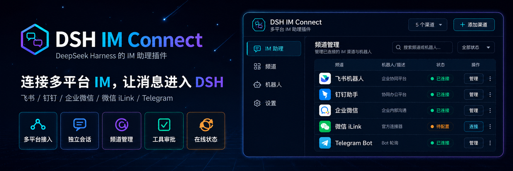

<p align="center">
  
</p>

<div align="center">

  # DSH IM Connect

  **Conecte Feishu, Lark, DingTalk, WeCom, WeChat, QQ, Telegram, Discord y Slack a su instancia local de DeepSeek Harness**

  [简体中文](README.zh-CN.md) · [English](README.en.md) · [日本語](README.ja.md) · [Español](README.es.md) · [Français](README.fr.md) · [Deutsch](README.de.md) · [Русский](README.ru.md) · [Português](README.pt.md) · [Registro de cambios](CHANGELOG.md) · [Apache-2.0](LICENSE)

  [](LICENSE)
  [](https://www.npmjs.com/package/@michengai/dsh-im-connect)
  [](https://www.npmjs.com/package/@michengai/dsh-im-connect)
  [](https://github.com/MichengAI/dsh-im-connect)
  [](https://nodejs.org/)
  [](#-canales-compatibles)
</div>

> DSH IM Connect es un complemento para DeepSeek Harness (DSH) mantenido por la comunidad, no un producto oficial de DeepSeek AI.

## Resumen de características

Incluso cuando esté lejos de su ordenador, envíe tareas a su DSH local a través de su aplicación de mensajería habitual, reciba respuestas, conteste preguntas y gestione la aprobación de herramientas en el mismo chat.

- **Conecte plataformas populares**: DingTalk, Feishu, Lark, WeChat, WeCom, QQ, Telegram, Discord y Slack.
- **Configuración individual por cuenta**: Añada múltiples cuentas en la misma plataforma; configure por separado el espacio de trabajo, modelo, nivel de razonamiento, permisos, acceso privado y método de envío.
- **Interacción directa desde el móvil**: Envíe instrucciones, lea respuestas y responda preguntas de opción única o múltiple; los usuarios aprobados pueden autorizar o rechazar la ejecución de herramientas directamente en chats privados.
- **Gestión independiente de sesiones**: Cada conversación de mensajería cuenta con una sesión aislada, consultable en la pestaña "Canales" del espacio de trabajo web.
- **Vinculación rápida por código QR o credenciales**: Conéctese fácilmente desde "Configuración → Asistente IM" y controle la recepción de mensajes por cuenta.
- **Control de acceso flexible**: Los grupos responden mediante menciones directas (@), mientras que los mensajes directos siguen las reglas de admisión configuradas.

## ¿Quién puede interactuar con el asistente?

Los mensajes entrantes se evalúan según el remitente antes de procesar comandos, aprobaciones de herramientas o inyecciones de contexto.

| Caso de uso | Comportamiento |
|---|---|
| Grupo sin mención (@) al bot | Se ignora sin responder ni generar solicitudes de aprobación; mencionar a otros miembros tampoco activa el bot |
| Grupo con mención explícita (@) al bot | No requiere vinculación previa: cualquier participante del grupo puede enviar tareas |
| Mensaje directo del usuario que escaneó el QR | Los usuarios de WeChat, Feishu, Lark y QQ que hayan escaneado el código QR se añaden automáticamente a la lista blanca |
| Mensaje directo de otros usuarios | Aparecen en la lista de espera de configuración hasta que un administrador los apruebe |
| Mensaje directo tras vinculación QR sin identidad de usuario | La vinculación rápida de DingTalk y WeCom solo devuelve credenciales del bot, por lo que el usuario debe ser aprobado en configuración |
| Mensaje directo mediante credenciales manuales | Telegram, Discord, Slack y vinculaciones manuales de DingTalk, WeCom y QQ requieren aprobación previa para cada chat privado |
| Mensaje directo sin identificador (userId) | Se rechaza automáticamente |
| Aprobación de herramientas | Responda `Aprobar` o `Rechazar` (`Approve` / `Deny`) directamente en el chat vinculado; válido en grupos y privados sin necesidad de abrir la interfaz web. Si no se responde en 5 minutos, la acción se cancela de forma segura |
| Selección interactiva | Responda con el número de opción o el texto en la conversación correspondiente; para selección múltiple use comas. En grupos, solo el iniciador de la tarea puede responder |

## 📡 Canales compatibles

<p align="center">
  <code>🔔 DingTalk</code>&nbsp;
  <code>🐦 Feishu</code>&nbsp;
  <code>🌐 Lark</code>&nbsp;
  <code>💬 WeChat</code>&nbsp;
  <code>🏢 WeCom</code>&nbsp;
  <code>🐧 QQ</code>&nbsp;
  <code>✈️ Telegram</code>&nbsp;
  <code>🎮 Discord</code>&nbsp;
  <code>💬 Slack</code>
</p>

| Canal | Método de vinculación | Recepción | Envío |
|---|---|---|---|
| **🔔 DingTalk** | Código QR / Manual | Webhook | Webhook / Tarjetas interactivas |
| **🐦 Feishu** | Código QR / Manual | Long Polling / Eventos | Open API / Mensajes interactivos |
| **🌐 Lark** | Código QR / Manual | Long Polling / Eventos | Open API / Mensajes interactivos |
| **💬 WeChat** | Código QR | Sondeo oficial sincronizado | Protocolo de sincronización nativo |
| **🏢 WeCom** | Código QR / Manual | Callback interno | Webhook / Tarjetas de mensajes |
| **🐧 QQ** | Código QR / Manual | WebSocket oficial / Webhook | OpenAPI / Markdown enriquecido |
| **✈️ Telegram** | Bot Token | Long Polling (getUpdates) | Telegram Bot API / Citas plegables |
| **🎮 Discord** | Bot Token | Gateway WebSocket | REST API |
| **💬 Slack** | Bot Token & App Token | Socket Mode WebSocket | Web API / Block Kit |

## Entrada de imágenes y archivos

Envíe capturas de pantalla, fotos o documentos (PDF, código, texto) directamente a la conversación. El modelo de visión de DSH los procesará automáticamente junto con sus instrucciones. Si DSH genera archivos (ZIP, texto, imágenes), se enviarán de vuelta a la conversación como archivos adjuntos nativos.

## Menú de acciones y comandos

Escriba `/menu` en el chat para desplegar botones interactivos que permiten cambiar de sesión, crear nuevas tareas o modificar modelos con un solo toque.

## Configuración del complemento

Disponible desde el panel de administración en **Complementos → @michengai/dsh-im-connect**:

### 1. Ubicación del acceso (`location`)
- **Predeterminado**: Solo configuración (`settings`)
- **Opciones**: `both` (barra lateral y ajustes), `sidebar` (solo barra lateral), o `settings` (solo en el menú de configuración global).

### 2. Mostrar sesiones de IM en el árbol de tareas (`taskTreeSessions`)
- **Predeterminado**: Desactivado (`false`)
- **Función**: Oculta las conversaciones de mensajería del árbol de tareas principal para evitar saturar el espacio de desarrollo diario.

### 3. Bloqueo de actualizaciones por configuración Cordis (`updater` / `onlineUpdate`)
- **Predeterminado**: Sin bloqueo (`undefined`)
- **Función**: Para entornos corporativos o sin conexión a Internet, deshabilite los puntos de enlace de actualización declarándolo en `cordis.patch.yml`:
  ```yaml
  - id: im-connect
    config:
      updater: false # o onlineUpdate: false
  ```
  Al bloquearse, el punto de actualización del complemento responde con HTTP 403, delegando el ciclo de vida al gestor oficial de DSH.

### 4. Política de activación en grupos de Telegram (`mentionPolicy` / `freeChatGroups`)
- **Predeterminado**: `addressed` (solo responde a menciones @ o respuestas directas al bot).
- **Función**: Configure si desea que el bot responda a todos los mensajes o defina una lista blanca de grupos sin necesidad de mención.

### 5. Mensaje de pensamiento plegable (`thinkingDisplay`)
- **Predeterminado**: Desactivado (`off`)
- **Función**: Envía la cadena de pensamiento del modelo en Telegram dentro de un bloque de cita plegable (`<blockquote expandable>`).

## Uso y comandos

Abra **Configuración → Asistente IM**, elija **Añadir cuenta** en el canal deseado y configure el espacio de trabajo, modelo, permisos y modo de envío.

| Objetivo | Acción | Notas |
| --- | --- | --- |
| Añadir cuenta | Seleccione **Añadir cuenta**, elija las preferencias y escanee o ingrese credenciales | Múltiples cuentas permitidas por canal |
| Modificar ajustes | Haga clic en Configuración en la fila de la cuenta | Cambios aplicados de inmediato |
| Pausar recepción | Desactive el interruptor **Recibir mensajes** | Las credenciales se conservan |
| Nueva sesión | Envíe `/new` o `/clear` | Inicia una sesión limpia en el canal |
| Estado / Ayuda | Envíe `/status` o `/help` | Muestra la sesión actual y comandos disponibles |
| Presets de agente | `/presets`, `/preset <número/ID>` | Cambia el perfil de agente activo |
| Modelo y razonamiento | `/models`, `/model <nombre>`, `/reasoning [nivel]` | Ajusta el modelo y esfuerzo de razonamiento |
| Gestión de sesiones | `/sessions`, `/session <número/ID>`, `/rename <título>`, `/fork` | Lista, cambia, renombra o bifurca sesiones |
| Recuperación de entregas | `/delivery`, `/delivery retry <ID>` | Reenvía mensajes que fallaron por desconexión |

### Nombres automáticos de temas en Telegram

Los temas de foros en Telegram se nombran automáticamente a partir del primer título de la sesión. Puede sincronizarlos manualmente con `/rename <título>`.

### Respuestas segmentadas

Permite dividir respuestas extensas en varios mensajes cortos sucesivos para una lectura más natural (activo actualmente en QQ).

### Rotación por inactividad

Si transcurre un período prolongado desde el último mensaje (ej. 1 hora, 6 horas), el siguiente mensaje iniciará automáticamente una nueva sesión.

### Conexión con Slack

1. Cree una aplicación en Slack API (`api.slack.com/apps`).
2. En **OAuth & Permissions → Bot Token Scopes**, añada los permisos de lectura, escritura, archivos y menciones.
3. Instale la app en su espacio de trabajo y obtenga el Bot Token (`xoxb-`).
4. Active **Socket Mode** y cree un App-Level Token (`xapp-`).
5. Configure ambos tokens en DSH para conectar mediante WebSocket nativo.

## Permisos y seguridad

- **API de gestión**: Utiliza `/api/dsh-im-connect` bajo las políticas de autenticación y protección de sesión nativas de DSH.
- **Almacenamiento de secretos**: Los tokens se resguardan de forma segura en las credenciales protegidas del host.
- **Aprobación de herramientas**: Permite autorizar comandos directamente en el chat sin exponer la consola web.

## Desarrollo y pruebas

```powershell
[Console]::OutputEncoding = [System.Text.Encoding]::UTF8
$OutputEncoding = [System.Text.Encoding]::UTF8
git clone https://github.com/MichengAI/dsh-im-connect.git
cd dsh-im-connect
npm install
npm test
dsh plugin --profile web add .
```

## Licencia

Consulte las directrices de seguridad en [SECURITY.md](SECURITY.md).
Distribuido bajo la [Licencia Apache 2.0](LICENSE).
